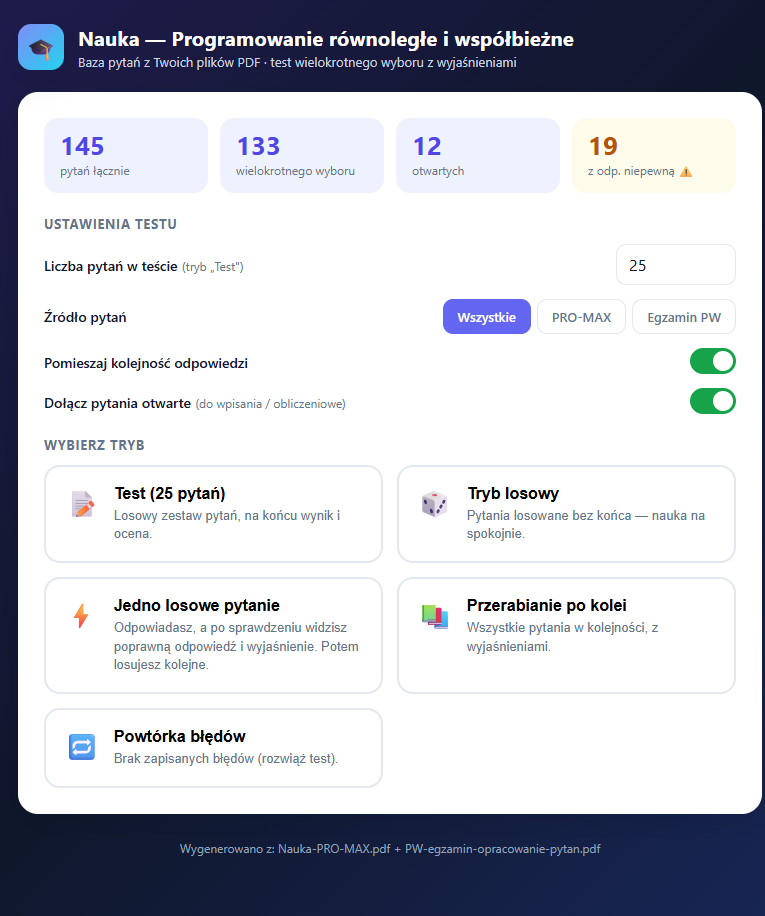
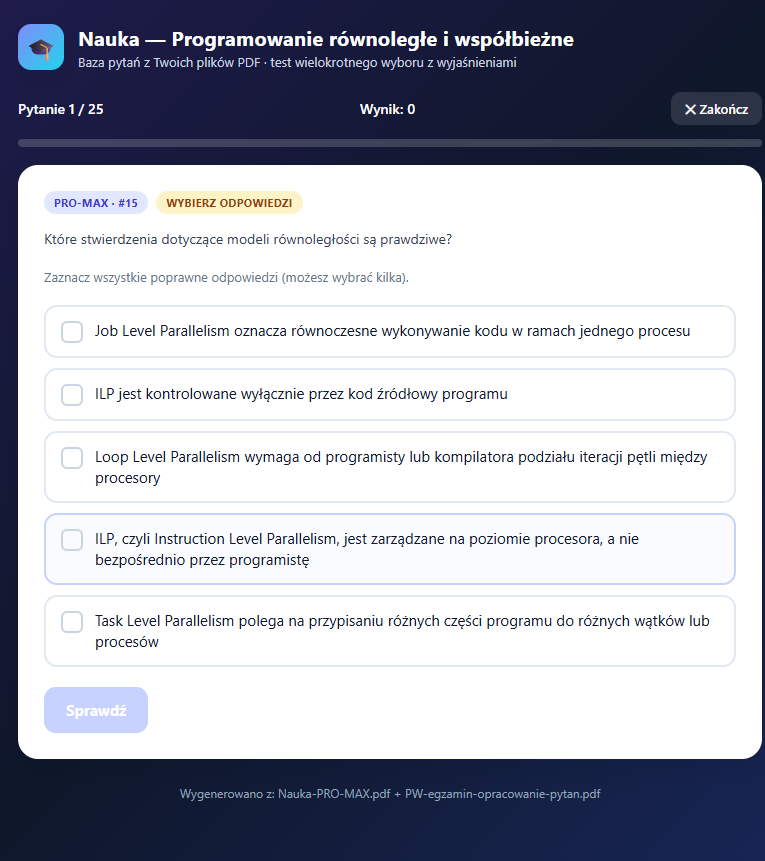

# Nauka — Parallel Programming Quiz

Nauka is a lightweight study app for learning parallel and concurrent programming. It provides a browser-based quiz experience and a SwiftUI implementation that can be integrated into an iOS project.

The repository contains the application code and the question data required to run the app. Original source documents and local working files are intentionally not included.

## Features

- 145 questions covering parallel and concurrent programming
- Multiple-choice and open-answer questions
- Five learning modes:
  - timed test with a final score
  - unlimited random practice
  - one random question at a time
  - sequential review
  - repetition of incorrectly answered questions
- Explanations and answer confidence indicators
- Question filtering by source
- Shuffle controls for questions and answers
- SwiftUI models, view models, and views for an iOS version
- Local-only operation with no account or network service required

## Screenshots

### Home screen



### Quiz screen



## Run the web app

The web version is a static application and does not require a build step.

1. Clone the repository.
2. Open [`index.html`](index.html) in a modern browser.

For a local development server, use any static file server. For example:

```bash
python -m http.server 8000
```

Then open <http://localhost:8000>.

## iOS integration

The SwiftUI source is provided as separate files so it can be added to a new Xcode project:

- `iOS_App_Models.swift` — Codable models and UI state
- `iOS_App_ViewModels.swift` — question repository, quiz manager, and local data manager
- `iOS_App_Views_Main.swift` — app entry point and main navigation
- `iOS_App_Views_Quiz.swift` — quiz flow and results
- `iOS_App_Views_Browser.swift` — question browser and search
- `iOS_App_Views_Stats_Settings.swift` — statistics and settings screens
- `questions.json` — question data for the iOS app

### Setup

1. Create a new **iOS App** project in Xcode with **SwiftUI** as the interface.
2. Add the six Swift files and `questions.json` to the app target.
3. Build and run on an iOS 15.0+ simulator or device.

The Swift files are source components rather than a complete `.xcodeproj`, so the project settings and signing configuration remain with the developer.

## Data and privacy

- No passwords, API keys, access tokens, or private keys are stored in this repository.
- The apps do not require a backend or user account.
- Quiz progress is stored locally by the iOS implementation.
- `.gitignore` excludes common local secrets, caches, editor files, and Xcode user data.

## Project structure

```text
.
├── index.html
├── questions.js
├── questions.json
├── screenshots/
└── iOS_App_*.swift
```

## License and content

This repository is a personal study project. Verify the copyright and distribution rights for any question material before redistributing it publicly.
